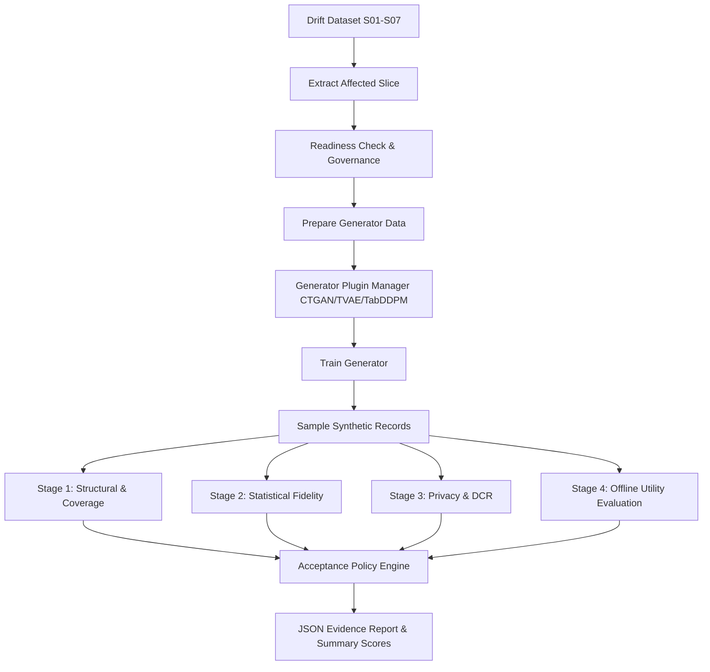

# Sprint 05 — Task 07: Automated Repair Experiment Runner

## 1. Project Information

Project: Intelligent MLOps Platform  
Group: J26-DS-361  
Component: Component 3 — Adaptive Intelligent Synthetic Data Repair Engine  
Sprint: 05 — Validation Engine and Repair Experiments  
Task: 07 — Build Automated Repair Experiment Runner  

Date: October 18, 2026  

## 2. Objective

Design, implement, and verify a modular automated repair experiment orchestrator that
standardizes execution across:
1. Scenario loading and safe slice extraction
2. Readiness governance and data preparation
3. Generator selection (CTGAN, TVAE, TabDDPM via `GeneratorPluginManager`)
4. Model training and synthetic sampling
5. End-to-end multi-stage validation (Structural, Fidelity, Privacy, Utility)
6. Acceptance policy synthesis
7. Reproducible JSON evidence reporting

## 3. Implemented Files

- `component3/src/experiments/automated_repair_runner.py`
- `component3/tests/test_automated_repair_runner.py`
- `component3/results/repair_experiments/`

## 4. Reused Components and Standards

- `component3/src/generators/plugin_manager.py` (`GeneratorPluginManager`)
- `component3/src/generators/data_preparer.py` (`prepare_generator_data`, `PreparedGeneratorData`)
- `component3/src/validation/` (`validate_structural`, `validate_fidelity`, `validate_privacy`, `evaluate_offline_utility`, `evaluate_repair_acceptance`)
- `shared/contracts/c3_output_schema.json`

## 5. Architecture and Workflow

## 6. Unit Testing Evidence

Test File: `component3/tests/test_automated_repair_runner.py`  
Command: `pytest component3/tests/test_automated_repair_runner.py -v`  
Result: 3 passed in 17.08 seconds (100% pass rate).

Test Scenarios Evaluated:
1. `test_runner_initialization`: Custom output directory creation and plugin manager verification.
2. `test_runner_invalid_inputs`: Safely rejects invalid scenarios, unknown generator names, zero/negative sample sizes, or invalid epochs.
3. `test_runner_end_to_end_smoke`: Executes full end-to-end pipeline (generation $\rightarrow$ all 4 validation stages $\rightarrow$ acceptance policy) and verifies JSON persistence.

## 7. Research Significance

Manual execution of 63+ experiments in Sprint 04 required bespoke scripting.  
The `AutomatedRepairExperimentRunner` provides a single reproducible entrypoint that enforces identical validation gates, metrics collection, and provenance tracking across all future generator and repair quantity evaluations.

## 8. Conclusion

Sprint 05 — Task 07 is fully implemented and verified with end-to-end smoke and unit tests.  
Proceeding to **Task 08: Test Different Generators and Repair Quantities** and **Task 09: Measure Slice, Overall, and Non-Affected Performance**.
